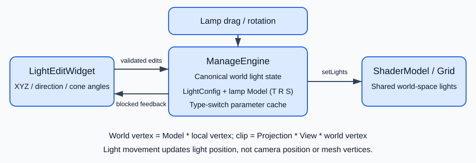

# 灯光与世界坐标（P0、P1、P2.1）

## 范围与数据流

已实现 P0（统一世界坐标与灯光同步）、P1（独立持久变换与拖动）、P2.1（数值编辑和双向回显）。未实现 P2.2 的 XYZ 轴拾取与约束拖拽，也未实现 P3 的强度调优、体积光。



图中 ManageEngine 是状态中心：界面输入通过校验后更新世界空间灯参数，并更新可见灯体；拖动、旋转灯体更新相同状态；每次变化发出 `lightChanged`，界面用 `QSignalBlocker` 回显。渲染只读取状态，所有物体接收同一份 `LightConfig`，不再针对每个物体重新瞄准灯。

## 坐标与交互

场景对象保存独立的位置、旋转、缩放，并按 `T * R * S` 生成模型矩阵；共享视图初始相机位于世界坐标 `(0,0,5)`，透视投影纵横比随有效视口更新。鼠标移动反投影起点和当前鼠标坐标到对象原始深度平面，保留抓取偏移与 Z；旋转以拖拽起点为基准，Ctrl+滚轮缩放当前选中对象。绘制不再修改对象状态。地面默认保持水平；天空盒去掉视图平移。世界坐标用于片元位置、法线、相机和灯光，所有对象接收同一份灯配置。

```text
Model = Translate(position) * Rotation * Scale
FragPosWorld = Model * vertexLocal
ClipPosition = Projection * View * Model * vertexLocal
CameraWorld = inverse(View)[3].xyz
SurfaceToPointLight = LightPositionWorld - FragPosWorld
```

`MvpData::model_` 现在包含物体平移、旋转、缩放，`view_` 只表示相机，不再当作物体偏移；因此 `model_[3].xyz` 表示模型原点的世界位置。移动灯体修改其位置与 Model，并同步点光、聚光的世界位置，无需改写顶点缓冲。旧的“灯偏移减物体偏移”补偿已删除，摄像机位置不随灯移动。初始相机 Z=5，物体默认 Z=0，选中后不会被强制搬到 Z=-12。

灯体平移仅改变位置；旋转灯体才改变光线传播方向。灯参数变更会同步灯体；灯体交互会通知面板，回显时阻断信号。类型切换保留位置、方向、聚光角度和衰减，单灯／多灯模式不会删除其余预设。当前面板只编辑第一盏灯，多灯模式中的其他灯仍为预设；不是多灯编辑器。平行光不使用位置，点光不使用方向，聚光使用两者及内外角。方向不能为零，角度须满足 `0 ≤ 内角 < 外角 < 90°`；无效输入显示错误且不提交。

网格应用模型矩阵；爆炸偏移在世界空间计算；实例渲染、拾取和描边使用对象矩阵乘实例矩阵。坐标轴跟随选中对象，不支持单轴拾取或约束拖拽（P2.2）；本次不包括 P3 体积光或调优。

## 修改文件与关键注释

| 文件（均位于 src 下，文档除外） | 修改点 |
| --- | --- |
| Engine\Renderables\Graphics.h | 独立 position、rotation、scale；rebuildModel 只从分量生成矩阵，防止重复缩放 |
| Engine\Scene\ManageEngine.h / .cpp | 共享 View/Projection；world-space 灯配置、类型缓存、syncLight、参数校验、灯旋转增量、轴跟随 |
| App\CustomOpenglWidget.h / .cpp | 移除 paintGL 状态写入；拖拽起点快照、深度反投影、对象独立缩放 |
| App\LightEditWidget.h / .cpp | 8 个数值控件、类型适用性、错误提示、阻断回显信号 |
| App\ParaConfigWidget.h / .cpp | 获取灯编辑器；固定灯树节点保存类型标记，不通过名称前缀猜测 |
| App\mainwindow.cpp | 界面参数写入引擎；lightChanged 回显；选中实际灯体打开灯面板 |
| Common\Translator.cpp | 新控件和错误提示的翻译 |
| Engine\Renderables\GridModel\grid_vertex.vert | Model 参与世界位置与逆转置法线计算 |
| Engine\Renderables\CubeMapsModel\CubeMapsModel.cpp | 天空盒移除相机平移而不是固定 +10 补偿 |
| Engine\Renderables\PlanteModel\PlanetModel.h / .cpp / vertex_shader.vert | 父 Model 与实例矩阵组合；实例描边和拾取保持一致 |
| Engine\Renderables\GeneralModel\ScreenRenderModel.h / .cpp | 非索引网格与实例绘制/拾取支持；拾取时禁用模板干扰并恢复 |
| Engine\Renderables\GeneralModel\pick_vertex.vs / stencil_vertex.vs | 按开关使用实例矩阵 |
| Engine\Renderables\GeneralModel\geometry_shader.geom | 爆炸偏移使用一致世界坐标，再做投影 |
| Doc\LightCoordinates-P0-P2.1.md / .svg | 修改说明、坐标公式和可直接显示的关系图 |

关键代码注释解释了 Model 不从旧矩阵累加、平移不重定向灯、反投影保留抓取偏移、统一世界灯配置以及回显信号阻断。未重写已有乱码注释和无关文件。

## 使用与回归检查

1. 点击灯体或树中的灯节点，打开灯参数面板；按灯类型启用位置、方向和聚光角度。
2. 输入位置 XYZ，确认灯体位置和场景照明同步改变。
3. 拖动灯体，确认位置回显且方向不变；切换旋转工具，确认方向回显改变。
4. 切换点光、平行光、聚光与单灯/多灯，确认第一盏灯的参数缓存保持。其余预设没有被删除。
5. 分别拖动、旋转、缩放不同物体，再反复选中，确认没有跳到固定 Z 或继承上个物体缩放。
6. 调整窗口比例；检查网格、天空盒、实例模型和描边。XYZ 轴当前只是跟随显示，不能独立拾取。

## 翻译修复

灯光位置 XYZ、方向 XYZ、内外锥角和非法参数提示使用 `Translator` 上下文的正式中英文 TS 条目，并生成到可执行文件旁的 `translations` 目录。删除根据旧标签是否翻译来猜测语言的中文字符串覆盖逻辑，避免源文件编码导致乱码。新增翻译须更新 TS 并重新生成 QM，运行中的界面需要重启才能加载新目录。

会话验证加载实际生成的 QM，逐一比较 8 个真实 QLabel 的完整中文文本，以及触发非法角度后的中文提示；也验证未加载目录时的英文回退和英文角度单位。

## 验证记录

使用 Visual Studio 工作区构建 `run_build`：成功；`git diff --check`：通过。

实际调用 `paintGl` 后读取两个不同平移物体与地面着色器的 GPU uniform：三个程序均链接成功，收到的位置完全等于同一世界灯位置，方向完全等于同一聚光方向，没有物体相关偏移或重新瞄准；灯体颜色拾取也通过。会话检查最终输出 `All checks passed`。

上述自动检查不等同于交互视觉验收；尚需在目标显卡和 DPI 环境手工检查光照外观、实际鼠标事件交互、地面、天空盒、实例描边及后处理。项目无本次任务专用的持久化自动测试工程；验证源代码保存在 `session-state\files\light-test`，不参与发布，临时构建产物已清理。
