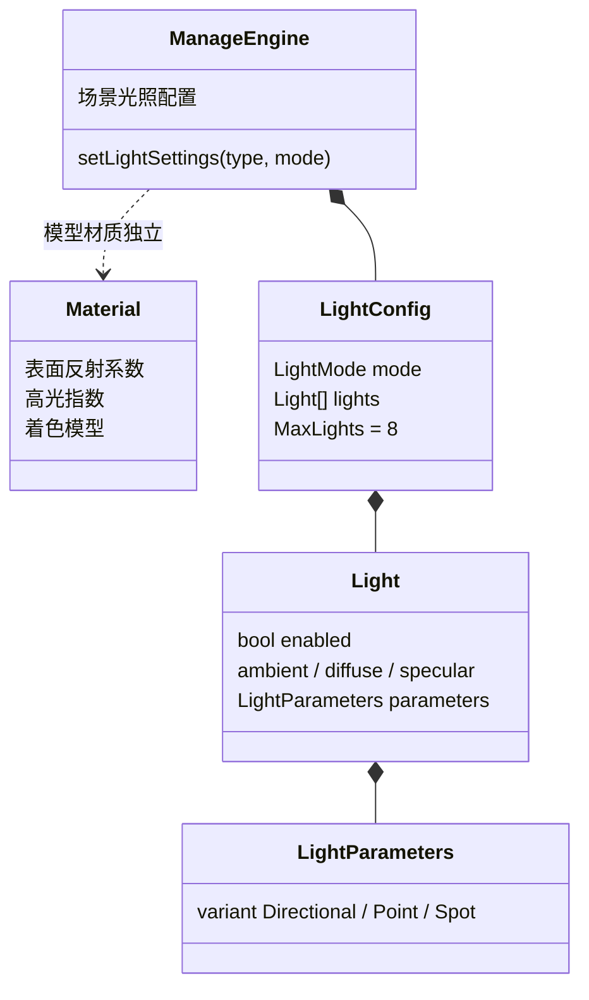
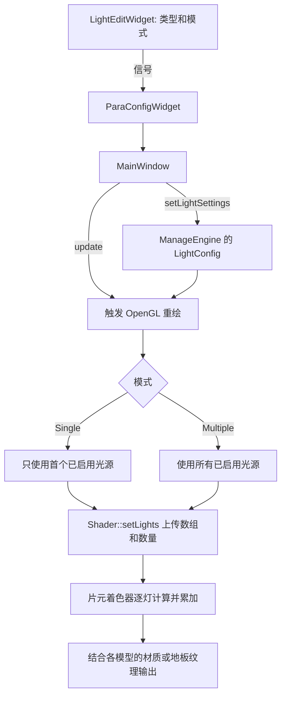

# 场景光照设计

## 职责与结构

光源是场景数据，材质是物体的表面数据；场景中的不同物体可使用不同材质，同时接受相同光源。`variant` 只保存当前光源类型对应的参数，避免类型和参数不一致。方向和位置均为世界坐标，方向表示光线传播方向。聚光角度由 CPU 转换为余弦值上传。

## 更新和绘制流程

当前界面只编辑第一盏灯的类型，单光源只使用第一盏灯；多光源额外启用预设点光和聚光。切换模式不删除预设。类型变化会重置第一盏灯的类型专属参数，但保留公共颜色。无光源时结果为黑色，不另加全局环境光。仅支持当前 UI 产生的配置；没有光源增删、参数编辑或序列化功能。

模型、地板和实例化星球使用统一的场景光源。天空盒、坐标轴和屏幕后处理不是受光表面，不参与光照。现有光照着色路径之前各自使用硬编码光源，新方案改成默认方向光和多光源预设，因此原有画面会发生变化。

## 优点、缺点及后续扩展

- 优点：UI 不再定义引擎领域类型；光照与材质解耦；单、多模式共用光源数据；三种类型共用衰减与光照计算；新增受光 shader 可复用公共模块。
- 缺点：目前多光源是固定预设、只能修改第一盏灯；每个模型每帧逐 uniform 上传，性能随光源和对象数量增长；最多支持 8 盏活动灯，CPU 与 GLSL 的上限需同步。着色器单独的环境光项会随灯数累加，亮度可能提高。
- 扩展光源编辑前，应引入稳定 ID、选中灯与增删接口，在引擎入口校验灯数、有限数值、非零方向、衰减分母和内外锥角；超过上限时拒绝并向 UI 报错，而不是只依赖渲染日志。加载/保存时应使用带版本的格式和稳定类型名，并处理未知类型。
- 数量增长后可使用 UBO/SSBO 等批量上传；阴影、PBR 和聚光等扩展应在保留世界坐标及类型映射约定的前提下独立演进。跨线程使用 Qt 队列信号时需要注册参数类型并确保配置线程安全。